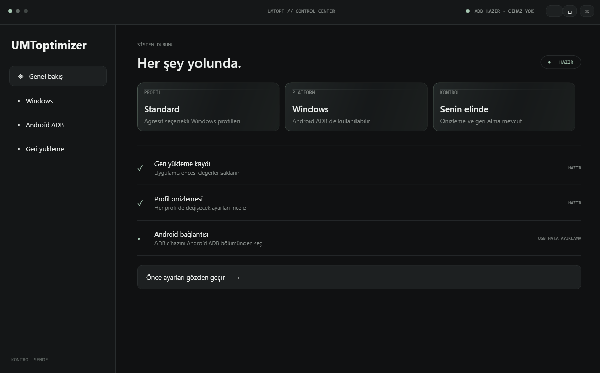

# UMToptimizer

**Windows masaüstü arayüzünden ve komut satırından Windows ve Android profillerini yöneten açık kaynaklı C# uygulaması.**

[İndir](https://github.com/umutlab/umtoptimizer/releases) · [Kaynak kod](https://github.com/umutlab/umtoptimizer) · [Sorun bildir](https://github.com/umutlab/umtoptimizer/issues)

> **Uyarı:** UMToptimizer Windows ve Android ayarlarını değiştirebilir. Bazı işlemler uygulama, dosya veya ağ ayarlarını etkileyebilir ve tam olarak geri alınamayabilir. Her cihazda aynı sonuç alınmaz; FPS, pil ömrü veya performans artışı garanti edilmez. Bir profili çalıştırmadan önce önizlemesini ve risk uyarılarını okuyun.

## İçindekiler

- [Uygulama hakkında](#uygulama-hakkında)
- [Özellikler](#özellikler)
- [Nasıl çalışır?](#nasıl-çalışır)
- [Windows profilleri](#windows-profilleri)
- [Android profilleri](#android-profilleri)
- [Android cihazı bağlama](#android-cihazı-bağlama)
- [Geri yükleme ve günlükler](#geri-yükleme-ve-günlükler)
- [Kurulum ve çalıştırma](#kurulum-ve-çalıştırma)
- [Komut satırı](#komut-satırı)
- [Kaynak koddan derleme](#kaynak-koddan-derleme)
- [Proje yapısı](#proje-yapısı)
- [Kapsam ve güvenlik sınırları](#kapsam-ve-güvenlik-sınırları)
- [Lisans](#lisans)

## Uygulama hakkında

UMToptimizer, Windows bilgisayardan Windows ayarlarını yönetmek ve ADB üzerinden bağlı Android cihaza profil komutları göndermek için geliştirilmiş bir masaüstü uygulamasıdır. WPF arayüzü ve komut satırı aynı profil kataloğunu kullanır. Android profilleri uygulamaya gömülü `.bat` kaynaklarından, Windows profilleri ise gömülü PowerShell betiğinden çalıştırılır.

Uygulama, Android cihazı hızlandırmayı veya pil ömrünü belirli bir oranda artırmayı vaat etmez. Profil açıklamaları, betiklerin neyi denemek üzere hazırlandığını anlatır. Komutların cihaz tarafından kabul edilmesi ve gerçek etkisi Android sürümüne, üretici yazılımına, donanıma ve kullanıcı izinlerine bağlıdır.

## Özellikler

- Koyu kontrol merkezi arayüzü: **Genel Bakış**, **Windows**, **Android ADB** ve **Geri Yükleme** bölümleri.
- Arayüz ve CLI tarafından paylaşılan tek profil kataloğu.
- Profil uygulanmadan önce değişiklik özeti ve uyarıların gösterilmesi; arayüzde ayrıca kullanıcı onayı.
- Android profil önizlemesinde kaynak betiğin komut satırlarının gösterilmesi.
- Hafif renk geçişleriyle oluşturulmuş liquid-glass görünümü; kısa sayfa, tıklama ve açılır menü animasyonları.
- Blur, shader veya sürekli çalışan animasyon döngüsü kullanmayan arayüz.
- EXE ve uygulama penceresi için çok çözünürlüklü UMToptimizer “U” simgesi.
- Uygulama açılışında ADB'nin uygulama klasöründe, Android SDK konumlarında ve `PATH` içinde aranması.
- Android sayfasında **adb.exe seç** ile ADB konumunu elle gösterme ve seçimi saklama.
- USB hata ayıklama yetkilendirme durumunun, ADB yenileme hatalarının ve bağlı cihazların arayüzde gösterilmesi.
- Uygulama açık kaldığı sürece cihazların yaklaşık beş saniyede bir taranması; yeni USB bağlantısında cihaz listesinin güncellenmesi.
- Son işlem bilgisinin `%LOCALAPPDATA%\UMToptimizer\last-change.json` dosyasına kaydedilmesi.
- Android profil komutlarının canlı akış olarak görüntülenmesi ve ayrıntılı işlem günlüğü.
- Profil bittikten sonra kullanıcı onayıyla cihazı yeniden başlatma seçeneği.
- Windows Standard ve Agresif (Performans) profillerinin yönetici izniyle çalıştırılması.

## Nasıl çalışır?

### Arayüz üzerinden

1. **Windows** veya **Android ADB** bölümünü açın.
2. İlgili profili seçin ve gösterilen açıklama, değişiklik özeti ve risk uyarılarını okuyun.
3. Android için bağlı ve yetkilendirilmiş cihazı seçin. Profil önizlemesinde komutları inceleyin.
4. Profil uygulama onayını verin. Windows profilleri yönetici izni ve betiğin kendi ek onaylarını isteyebilir.
5. Android çalışırken komut akışını ve sonuçları uygulama ekranından takip edin. İşlem bitince isterseniz cihazı ayrıca yeniden başlatın.

Android'de uygulama seçilen cihazın seri numarasını işlem boyunca kullanır. Böylece komutlar başlatıldıktan sonra başka cihaz bağlansa bile hedef cihaz değişmez. Profil satırlarından bazıları başarısız olursa kalan satırlar yine çalıştırılabilir; sonuç kısmen uygulanmış olabilir.

### Komut satırı üzerinden

Uygulama `--help` ile komutları listeler. CLI'da profili uygulama komutları için `--yes` parametresi açıkça verilmelidir. Bu parametre kullanıcı onayını komut satırında geçirir; profilin etkilerini veya risklerini azaltmaz. Önce `preview` komutunu çalıştırıp sonucu inceleyin.

## Windows profilleri

Windows profilleri `Resources\Windows\UMToptimizer-Windows.ps1` dosyasındaki betik kullanılarak çalışır. Profil seçildikten sonra uygulama değişiklik özetini sunar ve onay ister. Betik ayrı PowerShell sürecinde yönetici izniyle çalışır ve bazı işlemler için kendi ek onaylarını gösterebilir.

### Standard

Günlük kullanıma yönelik, Windows gizlilik ve sistem davranışı ayarlarını düzenleyen profildir. Betik sürümüne göre telemetri, etkinlik geçmişi, konum ve harita davranışı, bazı arka plan özellikleri ve hizmetler değiştirilebilir. Geçici dosyalar temizlenir ve hazırda bekletme kapatılır. Bazı Dosya Gezgini/Store davranışları ve Defender örnek gönderme ayarı da düzenlenebilir.

Betik kayıt defteri ve hizmet ayarlarını yedeklemeye ve mümkünse Sistem Geri Yükleme noktası oluşturmaya çalışır. Geçici dosyalar ve bazı önbellekler silindiğinden bu işlemlerin tamamı geri getirilemez. BitLocker ile ilgili işlem ayrı kurtarma anahtarı onayı gerektirebilir; anahtar bilinmiyorsa devam etmeyin.

### Agresif (Performans)

Standart profilin değişikliklerine ek olarak daha geniş Windows arayüzü, ağ, tarayıcı ve isteğe bağlı bileşen ayarlarını değiştirmeyi dener. Kaynak betikte IPv6/Teredo, bildirimler, arama ve arka plan davranışları, tarayıcı ilkeleri ve seçili Windows hizmetleriyle ilgili değişiklikler bulunur. OneDrive, Edge, Copilot/AI bileşenleri veya seçili isteğe bağlı uygulamaların kaldırılması denenebilir. Edge profili silinebilir. Betik çevrimiçi bir Adobe alan adı listesini `hosts` dosyasına ekleyip DNS önbelleğini temizleyebilir.

Bu işlemler ağ bağlantısını, VPN'i, tarayıcıları, bildirimleri veya üretici araçlarını etkileyebilir. Kaldırılan uygulamalar, silinen profil verileri ve dosyalar yedekleme/geri yükleme ile geri gelmeyebilir. `hosts` dosyasına eklenen satırların eksiksiz geri alınacağı garanti edilmez. Agresif profilin performans artışı garanti edilmez.

## Android profilleri

Android profilleri ADB ile bağlı telefona gönderilir. Kaynak betiklerdeki komutlar üreticiye ve Android sürümüne göre reddedilebilir, yok sayılabilir veya kısmen uygulanabilir. Profil isimleri ve açıklamaları betiklerin hedefini anlatır; tüm Android cihazlarda aynı davranışı garanti etmez.

| Profil | Hedefi | Dikkat edilmesi gerekenler |
