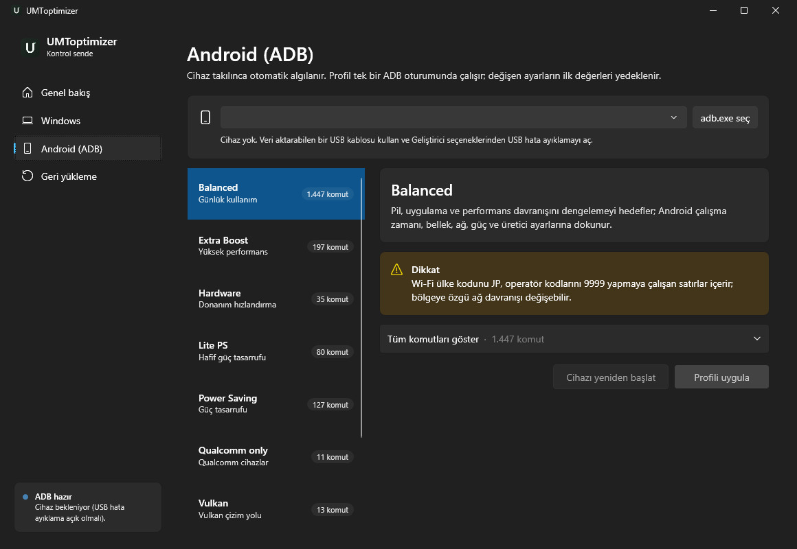

<div align="center">

[](https://github.com/umutlab/umtoptimizer/releases)
[](https://github.com/umutlab/umtoptimizer/releases/latest)
[](LICENSE)
[](https://github.com/umutlab/umtoptimizer/stargazers)
[](https://github.com/umutlab/umtoptimizer/actions/workflows/build.yml)

# UMToptimizer 3

UMToptimizer Web : https://umtoptimizer.vercel.app



**Windows ve Android (ADB) için açık kaynak optimizasyon kontrol merkezi.**
Baştan yazılmış, test edilmiş ve güvenlik denetiminden geçmiş sürüm.

[İndir](https://github.com/umutlab/umtoptimizer/releases) · [Kaynak kod](https://github.com/umutlab/umtoptimizer) · [Sorun bildir](https://github.com/umutlab/umtoptimizer/issues)

</div>

> ⚠️ Bu araç sistem ayarlarını değiştirir. Her uygulamadan önce otomatik yedek alır ve tek tıkla geri yükleme sunar; yine de **Agresif** Windows profili bazı uygulamaları kalıcı olarak kaldırır. Uygulamadan önce açıklamaları okuyun.

---

## İçindekiler
1. [Kurulum](#kurulum)
2. [Ne yapar?](#ne-yapar)
3. [Sürüm 3'te neler değişti?](#sürüm-3te-neler-değişti)
4. [Orijinal kodda bulunan hatalar](#orijinal-kodda-bulunan-hatalar)
5. [Güvenlik denetimi](#güvenlik-denetimi)
6. [Kod incelemesi](#kod-incelemesi)
7. [Testler](#testler)
8. [Arayüz ve erişilebilirlik](#arayüz-ve-erişilebilirlik)
9. [Mimari](#mimari)
10. [Komut satırı](#komut-satırı)
11. [Derleme](#derleme)
12. [Veriler nerede tutulur?](#veriler-nerede-tutulur)
13. [Bilinen sınırlamalar](#bilinen-sınırlamalar)

---

## Kurulum

`UMToptimizer-Setup-3.0.0.exe` dosyasını çalıştırın.

- **.NET kurulu olması gerekmez.** Uygulama self-contained tek bir exe olarak paketlenir.
- **"Yalnızca benim için"** seçilirse yönetici izni istenmez; "tüm kullanıcılar" seçilirse istenir.
- Kurulumda isteğe bağlı olarak **Android Platform Tools (ADB)** resmi Google sunucusundan indirilir.
- Windows 10 1809 ve üzeri, x64.

> Setup imzalı değildir; Windows SmartScreen "bilinmeyen yayımcı" uyarısı gösterebilir. "Ek bilgi → Yine de çalıştır" ile devam edebilirsiniz.

---

## Ne yapar?

### Windows profilleri
| Profil | Özet |
|---|---|
| **Standart** (önerilen) | Telemetri, etkinlik geçmişi, konum ve tüketici özelliklerini kapatır; DiagTrack/WerSvc gibi hizmetleri sınırlar; geçici dosyaları temizler; hazırda bekletmeyi kapatır. |
| **Agresif** | Standart'ın tamamı + animasyon/bildirim azaltma, IPv6/Teredo kapatma, Edge/Brave politikaları, Copilot/Recall, Edge/OneDrive ve isteğe bağlı uygulamaları kaldırma, Adobe hosts engelleme listesi. |

Her ikisi de önce **kayıt defteri + hizmet + IPv6 + Defender + ayrılmış depolama yedeği** alır, isteğe bağlı olarak Sistem Geri Yükleme noktası oluşturur.

### Android profilleri (ADB)
Balanced (1.447 komut), Extra Boost, Hardware, Lite PS, Power Saving, Qualcomm only, Vulkan, Compile.
Komutların **%95'ten fazlası** (`settings`, `setprop`, `device_config`) uygulama öncesi değerleri yedeklendiği için **geri alınabilir**.

---

## Sürüm 3'te neler değişti?

| Konu | Sürüm 1–2 | Sürüm 3 |
|---|---|---|
| Android hızı | Her komut için ayrı `adb.exe` süreci (Balanced ≈ 1.500 süreç) | Tüm profil **tek** `adb shell` oturumunda |
| Android geri alma | Yok ("otomatik geri alınamaz") | Değişen her ayarın ilk değeri 5 komutla yedeklenir, tek tıkla geri yüklenir |
| Cihaz algılama | 5 sn'de bir yoklama | `adb track-devices` akışı (anında, süreç açmadan) |
| ADB kurulumu | Kullanıcı elle kurar | Uygulama veya setup resmi paketi tek tıkla indirir |
| Windows betiği | Ayar listesi ile yedek listesi ayrı ayrı elle yazılmış | Tek tablo; yedek ve geri yükleme bu tablodan **türetilir** |
| Windows çalıştırma | Görünür PowerShell penceresinde sorular | Arka planda; seçenekler arayüzde, günlük canlı akar |
| Arayüz | ~600 satır C# ile elle kurulan kontroller | XAML + Windows 11 Fluent tema (Mica, açık/koyu) |
| Testler | Yok | 46 xUnit testi + 26 PowerShell betik kontrolü |
| Dağıtım | .NET runtime gerektiren zip | Tek setup.exe, runtime gömülü |

**Kod miktarı:** C# arayüz kodu 586 → ~210 satır. Toplam kod yeni özelliklere rağmen yaklaşık %15 daha kısa.

---

## Orijinal kodda bulunan hatalar

Orijinal kaynak satır satır okunarak bulundu; hepsi sürüm 3'te düzeltildi.

1. **Cihaz listesi büyük olasılıkla hiç dolmuyordu.** `adb devices -l` alanları boşlukla ayırır; kod sekme karakteri arıyordu. (Test: `DevicesLong_SpaceSeparated_IsParsed`)
2. **IPv6 ayarları yedeklenmiyordu.** Yedek hesaplanıyor ama `backup.json`'a yazılmıyordu; geri yükleme IPv6'yı hiç geri getirmiyordu.
3. **Hazırda bekletme yanlışlıkla kapatılabiliyordu.** Geri yüklemede yedekte değer yoksa hazırda bekletme açılmak yerine kapatılıyordu.
4. **Yedek listesi uygulanan ayarlarla uyuşmuyordu.** Yanlış yollar (`Policies\Microsoft\BraveSoftware`, `ControlSet001`) ve onlarca tekrar satır vardı.
5. **İkinci uygulama yedeği eziyordu.** Geri yükleme orijinal hâle değil, zaten değiştirilmiş hâle dönüyordu.
6. **Bir komut her zaman başarısız oluyordu.** `Power_Saving` profilinde tamamı tek tırnakla sarılmış satır vardı. Balanced'da da 49 tekrar komut vardı.
7. **Hosts listesi her çalıştırmada tekrar ekleniyordu** ve geri yüklemede kaldırılmıyordu.
8. **Ölü kod vardı:** güç planı ve tekil Android ayarı akışları hiç kullanılmıyordu.

---

## Güvenlik denetimi

Masaüstü uygulamasının saldırı yüzeyi incelendi: yönetici olarak çalışan betik, ADB komut üretimi, indirmeler ve diskteki yedek dosyaları.

| # | Önem | Açık | Düzeltme | Test |
|---|---|---|---|---|
| G1 | **Yüksek: yerel yetki yükseltme** | `%ProgramData%` altında standart kullanıcılar klasör oluşturup **sahibi** olabilir (`BUILTIN\Users:(CI)(WD,AD)`). Saldırgan `UMToptimizer` klasörünü önceden oluşturup sahte bir `backup.json` bırakırsa, yönetici "Geri yükle"ye bastığında betik saldırganın seçtiği HKLM değerlerini (ör. hizmet `ImagePath`) yazar. Junction/symlink ile de keyfi dosyaya yazdırılabilir. | (1) Her çalıştırmada klasördeki bağlantılar silinir, sahip *Administrators* yapılır, yazma yalnızca SYSTEM/Administrators'a verilir. (2) Geri yükleme bir **beyaz liste** uygular: yalnızca betik tablosundaki anahtar ve hizmetler, yalnızca geçerli değer türleri. | `WindowsScript.Tests.ps1` §4–5: sahte `ImagePath` ve `Spooler` girdisi **yazılmadı** |
| G2 | **Orta: TOCTOU** | Betik kullanıcının yazabildiği `%TEMP%`'e yazılıp `-File` ile yönetici olarak çalıştırılıyordu. UAC onayı ile çalışma arasında başka bir süreç dosyayı değiştirebilirdi. | Yükseltilmiş PowerShell metni **belleğe** okur, SHA-256'sını exe'ye gömülü özetle karşılaştırır ve yalnızca eşleşirse bellekteki metni çalıştırır. Dosyaya bir daha bakılmaz. | `ElevatedCommand_RejectsTamperedScript`: kurcalanmış betik `exit 3` ile reddedildi, hiç çalışmadı |
| G3 | **Orta: hosts zehirleme** | Üçüncü taraf GitHub listesi doğrulanmadan sistemin `hosts` dosyasına ekleniyordu. Liste ele geçirilirse `1.2.3.4 banka.com` gibi yönlendirmeler eklenebilirdi. | Yalnızca `0.0.0.0 alan.adi` / `127.0.0.1 alan.adi` engelleme satırları kabul edilir. Blok işaretlerle eklenir ve geri yüklemede kaldırılır. | `WindowsScript.Tests.ps1` §6 |
| G4 | **Düşük: cihazda komut enjeksiyonu** | Android yedek JSON'undaki anahtar adları cihaz kabuğuna tırnaksız gidiyordu; `x; reboot` gibi bir anahtar komut çalıştırabilirdi. | Anahtar ve ad alanı `[A-Za-z0-9_.:/-]` beyaz listesiyle doğrulanır, değerler her zaman tek tırnakla kaçışlanır. | `RestoreCommand_RejectsUnsafeInput`, `RestoreCommand_ValueInjection_IsQuoted` |
| G5 | **Düşük: günlük yolu** | `-LogPath` parametresi dışarıdan geliyordu; yönetici betiği herhangi bir yola yazabilirdi. | Yalnızca `%ProgramData%\UMToptimizer\logs\` altı kabul edilir, `..` reddedilir. | `WindowsScript.Tests.ps1` §7 |
| G6 | **Düşük: yanlış kullanıcı** | Standart kullanıcı başka bir yönetici parolasıyla yükseltirse HKCU/TEMP **yöneticinin** profilini gösterir; ayarlar yanlış hesaba yazılırdı. | Uygulama kendi SID'ini iletir; betik HKCU'yu `HKEY_USERS\<SID>`'e yönlendirir. | `WindowsScript.Tests.ps1` §8 |

**Kontrol edilip sorun bulunmayanlar:**
- Kaynakta gömülü parola, anahtar veya token yok.
- ZIP açarken yol dışına çıkma (zip-slip) yok; .NET `ExtractToDirectory` bunu engelliyor.
- ADB yalnızca HTTPS ile `dl.google.com`'dan iniyor.
- Uygulamanın kendisi yönetici olarak çalışmıyor; yalnızca Windows betiği UAC ile yükseltiliyor.

**Kalan risk:** İndirilen `platform-tools` paketi için Google sabit bir özet yayımlamadığından içerik özeti doğrulanmıyor; güven HTTPS'e dayanıyor.

---

## Kod incelemesi

Kod 8 açıdan incelendi: satır satır, kaldırılan davranış, dosyalar arası, tekrar kullanım, sadeleştirme, verimlilik, doğru katman ve kurallar. 10 bulgu çıktı; 9'u düzeltildi.

| Bulgu | Durum |
|---|---|
| Android geri yükleme yarıda kesilirse yedek dosyası yine de **siliniyordu** → orijinal değerler kaybolabilirdi | ✅ Yalnızca oturum sonuna kadar tamamlandıysa güncelleniyor; başarısız girdiler saklanıyor |
| Cihaz erken çıkınca stdin yazımı "pipe ended" atıyor, gerçek hata gizleniyordu | ✅ |
| Başka hesapla yükseltmede HKCU yanlış kullanıcıya yazılıyordu | ✅ (G6) |
| Boş (`""`) Android ayarları "yok" sayılıp geri yüklemede siliniyordu | ✅ |
| `track-devices` stderr'i okunmuyordu, boru dolarsa kilitlenebilirdi | ✅ |
| Hosts geri yüklemesi dosyayı ASCII yazıp Türkçe karakterleri bozuyordu | ✅ |
| Kilitli JSON dosyası arayüzü düşürüyordu | ✅ |
| İşlem sürerken pencere kapanınca kapalı pencereye mesaj gösteriliyordu | ✅ |
| Kullanılmayan `NotUndoable` alanı | ✅ Kaldırıldı |
| Rozet, tüm Android betiklerini açılışta yüklüyor | ➖ Ölçüldü: ~120 KB, milisaniyeler; değişiklik gerekmedi |

**Testlerin yakaladığı ek hata:** PowerShell'de değişken adları büyük/küçük harf duyarsızdır. `Save-Backup` içindeki yerel `$backup` sözlüğü, dosya yolu olan `$Backup` değişkenini eziyordu. Sonuçta yedek `backup.json` yerine çalışma klasöründe `System.Collections.Specialized.OrderedDictionary` adlı bir dosyaya yazılıyordu; yani Windows geri yüklemesi hiç çalışmayacaktı. Testler olmasaydı bu fark edilmezdi.

---

## Testler

```powershell
dotnet test tests\UMToptimizer.Tests                                          # 46 xUnit testi
powershell -NoProfile -ExecutionPolicy Bypass -File tests\WindowsScript.Tests.ps1   # 26 betik kontrolü
```
`build.ps1` ikisini de setup üretmeden önce çalıştırır; biri başarısız olursa setup üretilmez.

| Dosya | Kapsam |
|---|---|
| `tests/UMToptimizer.Tests/CoreTests.cs` | Profillerin yüklenmesi, `adb shell` öneki ve tekrarların ayıklanması, eski CLI takma adları; `adb devices` ayrıştırma (boşluk/sekme/yetkisiz/daemon satırları); geri alınabilir komut tanıma; `settings list`/`getprop`/`device_config` çıktısı ayrıştırma (değerde `=`, `]` ile biten değer, boş değer); geri yükleme komutu üretimi ve **enjeksiyon reddi**; yükseltilmiş komutun SHA-256 sabitlemesi ve **kurcalanmış betiğin gerçek PowerShell'de reddedilmesi** |
| `tests/WindowsScript.Tests.ps1` | Betiği gerçek sisteme dokunmadan, yalnızca `HKCU:\Software\UMToptimizerTest` ve geçici bir klasörle çalıştırır: yedek → uygula → ikinci yedek ezilmez → kurcalanmış yedek → geri yükle (DWord/Binary/olmayan değer/olmayan anahtar) → hosts filtresi → günlük yolu doğrulaması → HKCU yönlendirmesi |

Ayrıca elle doğrulananlar:
- Setup sessiz kurulum, kurulu exe'nin çalışması, Başlat menüsü kısayolu ve kaldırmanın her şeyi temizlemesi.
- Gerçek `adb` ile cihaz listesi.
- Uygulama içinden ADB indirme ve açma.
- UI Automation ile sayfa geçişleri, Ctrl+1..4 kısayolları ve erişilebilir adlar.

---

## Arayüz ve erişilebilirlik

- **Windows 11 Fluent tema:** sistem açık/koyu temasını izler, Mica arka plan. Özel kontrol şablonu yerine temanın kendi renk anahtarları kullanılır.
- **Klavye:** `Ctrl+1` Genel bakış, `Ctrl+2` Windows, `Ctrl+3` Android, `Ctrl+4` Geri yükleme. Açılışta odak gezinmede.
- **Ekran okuyucu:** simge düğmeleri, listeler, cihaz seçici ve günlük için `AutomationProperties.Name` tanımlı. İşlem durumu ve ADB durumu `LiveSetting=Polite` ile duyurulur.
- **Güvenli onay:** riskli işlemlerde varsayılan düğme **Hayır**; yanlışlıkla Enter'a basmak sistemi değiştirmez.
- **Geri bildirim:** ortak işlem paneli (ilerleme çubuğu ve canlı günlük) ile görev çubuğu ilerlemesi. İşlem sürerken eylem düğmeleri kilitlenir.
- **Durum tek yerde:** ADB, cihaz ve yedek durumları tek bir `Refresh()` fonksiyonundan güncellenir.

---

## Mimari

```
src/UMToptimizer/
  Program.cs               Argüman yoksa arayüzü, varsa komut satırını başlatır
  App.xaml(.cs)            Fluent tema, ortak stiller (kart, uyarı, gezinme, profil kartı)
  MainWindow.xaml(.cs)     Arayüz; detay panelleri seçili profile XAML ile bağlı
  Core/
    Profiles.cs            Tek profil kaydı + katalog; Android komutları ilk erişimde yüklenir
    Adb.cs                 ADB bulma/indirme, track-devices, tek oturumda uygulama, ilk-değer yedeği, geri yükleme
    WindowsTweaks.cs       Hash doğrulamalı yükseltilmiş çalıştırma, günlüğü canlı izleme
    Store.cs               Yollar, JSON okuma/yazma, süreç çalıştırıcı
    Cli.cs                 Komut satırı (pattern matching)
  Resources/
    Windows/UMToptimizer-Windows.ps1   Tablo tabanlı Windows profilleri (tek kaynak)
    Android/*.bat                      Orijinal Android profilleri (değiştirilmedi)
tests/
  UMToptimizer.Tests/      xUnit
  WindowsScript.Tests.ps1  Betik testleri
installer/UMToptimizer.iss Inno Setup betiği
build.ps1                  Test → publish → setup
```

**Android uygulama akışı:**
1. Tek oturumda `settings list global|system|secure`, `getprop` ve `device_config list` okunur.
2. Profilin değiştireceği her anahtarın **ilk** değeri `android\<seri>.json`'a yazılır. Daha önce kaydedilmiş anahtarların üzerine yazılmaz.
3. Profil tek `adb shell` oturumunda çalışır. Her komut `</dev/null` ile çalıştırılır, böylece betiğin geri kalanını okuyup tüketemez. Başarısızlar `@@F<n>` işaretiyle raporlanır.
4. Cihazın reddettiği komutların yedekleri silinir; zaten hiçbir şeyi değiştirmemişlerdir.

---

## Komut satırı

```
UMToptimizer profiles
UMToptimizer windows apply <standard|aggressive> --yes [--restore-point] [--allow-bitlocker]
UMToptimizer windows restore --yes
UMToptimizer android devices
UMToptimizer android preview <profil>
UMToptimizer android apply <profil> [--serial ID] --yes
UMToptimizer android restore [--serial ID]
UMToptimizer android install-adb
```
Sistemi değiştiren her komut `--yes` olmadan çalışmaz; yalnızca ne yapacağını gösterir.

---

## Derleme

```powershell
winget install Microsoft.DotNet.SDK.10 JRSoftware.InnoSetup   # bir kez
.\build.ps1                    # test → publish → dist\UMToptimizer-Setup-3.0.0.exe
.\build.ps1 -Version 2.1.0     # farklı sürüm
```

---

## Veriler nerede tutulur?

| Ne | Nerede |
|---|---|
| Android ilk-değer yedekleri | `%LOCALAPPDATA%\UMToptimizer\android\<seri>.json` |
| İndirilen ADB | `%LOCALAPPDATA%\UMToptimizer\platform-tools` |
| Android günlükleri | `%LOCALAPPDATA%\UMToptimizer\logs` |
| Windows yedeği ve günlükleri | `%ProgramData%\UMToptimizer` (yalnızca yöneticiler yazabilir) |

Program kaldırıldığında bu veriler bilerek silinmez; yeniden kurup geri yükleme yapabilirsiniz.

---

## Bilinen sınırlamalar

Dürüstlük için: aşağıdakiler henüz **gerçek ortamda uçtan uca** test edilmedi.

- **Android profil uygulama ve geri yükleme gerçek bir telefonda denenmedi.** Ayrıştırma ve komut üretimi birim testlerle doğrulandı. Uygulama testleri sırasında bağlı cihaz yoktu.
- **Windows profillerinin yönetici olarak tam çalışması denenmedi**, çünkü test bilgisayarının ayarlarını değiştirirdi. Yedek, uygulama ve geri yükleme mantığı test anahtarında doğrulandı. Hizmetler, AppX kaldırma, DISM gibi yönetici gerektiren adımlar yalnızca kod incelemesinden geçti.
- **Bazı adımlar geri alınamaz:** kaldırılan uygulamalar (Edge, OneDrive vb.), silinen geçici dosyalar, Explorer klasör görünümü önbelleği ve Android `pm compile`.
- **Setup imzalı değil.**

---

## Lisans
MIT. Ayrıntılar için [LICENSE](LICENSE).
